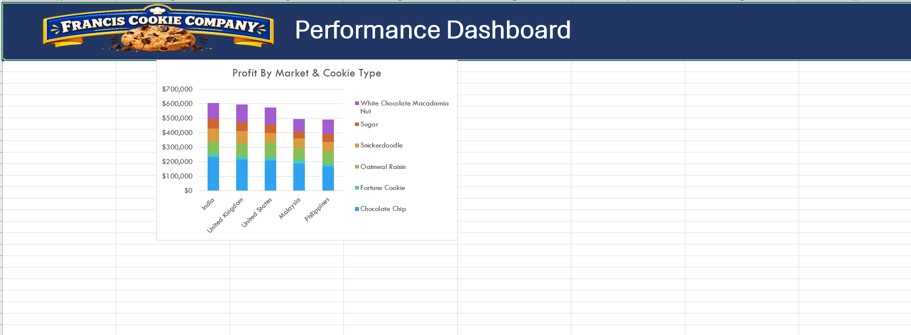

# 🍪 Cookie Company Interactive Dashboard

An interactive **Microsoft Excel dashboard** designed to analyze and visualize Cookie Company sales performance across products, countries, and time periods.

The project demonstrates practical **data cleaning, data-quality validation, exploratory analysis, KPI development, PivotTables, PivotCharts, and dashboard design** using Excel.

---

## 📊 Project Overview

This project analyzes Cookie Company sales data containing information about:

- 🌍 Country
- 🍪 Product
- 📦 Units Sold
- 💰 Revenue
- 💵 Cost
- 📈 Profit
- 📅 Date

The dataset contains sales records across multiple countries and product categories, allowing the dashboard to provide insights into **sales volume, revenue, cost, profitability, product performance, country performance, and monthly trends**.

The project is being developed as an **Excel-based data analytics portfolio project**, with an emphasis on transforming raw business data into an interactive and decision-supporting dashboard.

---

## 🎯 Project Objectives

The primary objectives of this project are to:

1. Analyze overall sales performance.
2. Track Revenue, Cost, Profit, and Units Sold.
3. Compare performance across countries.
4. Analyze product-level sales performance.
5. Identify monthly sales and profitability trends.
6. Build interactive visualizations using Excel.
7. Apply data-quality checks before analysis.
8. Demonstrate professional Excel analytics and dashboard development practices.

---

## 🗂️ Dataset

The Excel workbook currently contains six worksheets:

| Worksheet                    |    Records / Content | Description                                                           |
| ---------------------------- | -------------------: | --------------------------------------------------------------------- |
| `Data`                       |          700 records | Primary sales dataset                                                 |
| `New Data`                   |          525 records | Additional sales data; contains records overlapping with `Data`       |
| `Dashboard`                  |            Dashboard | Main dashboard containing the branded header and first chart          |
| `Sheet1`                     |           PivotTable | Supporting PivotTable worksheet                                       |
| `Sheet1 (2)`                 |           PivotTable | Supporting PivotTable worksheet                                       |
| `Profit By Country & Cookie` | PivotTable and chart | Profit summary by country and cookie product, with a supporting chart |

### Dataset Columns

| Column       | Description                              |
| ------------ | ---------------------------------------- |
| `Country`    | Country associated with the sales record |
| `Product`    | Cookie product sold                      |
| `Units Sold` | Number of units sold                     |
| `Revenue`    | Revenue generated from the sale          |
| `Cost`       | Cost associated with the sale            |
| `Profit`     | Profit generated from the sale           |
| `Date`       | Date of the sales record                 |

---

## 🔎 Data Quality Audit

Before building the dashboard, the dataset was reviewed for common data-quality issues.

### Confirmed Findings

| Check                   | Result                  | Status |
| ----------------------- | ----------------------- | ------ |
| Missing values          | None identified         | ✅     |
| Internal duplicate rows | None identified         | ✅     |
| Negative Units Sold     | None identified         | ✅     |
| Negative Revenue        | None identified         | ✅     |
| Negative Cost           | None identified         | ✅     |
| Negative Profit         | None identified         | ✅     |
| Zero Units Sold         | None identified         | ✅     |
| Zero Revenue            | None identified         | ✅     |
| Zero Cost               | None identified         | ✅     |
| Zero Profit             | None identified         | ✅     |
| Invalid country values  | None identified         | ✅     |
| Invalid product values  | None identified         | ✅     |
| Date formatting         | Valid                   | ✅     |
| Profit calculation      | Consistent              | ✅     |
| Cross-sheet duplication | 525 overlapping records | ⚠️     |

### Important Data-Quality Finding

The `New Data` worksheet contains **525 records that exactly match records already present in the `Data` worksheet**.

Therefore, simply appending both worksheets would result in duplicate records and could inflate:

- Revenue
- Cost
- Profit
- Units Sold
- Record counts

The duplicate records were therefore treated as a **data-quality consideration rather than blindly combining both worksheets**.

> **Important:** The repeated `Country + Product + Date` combinations within the dataset were not automatically classified as duplicates because multiple legitimate sales records may exist for the same country, product, and date.

---

## 📈 Key Analytical Areas

The dashboard is being developed around several areas of business performance.

### KPI Analysis

Planned key performance indicators include:

- **Total Revenue**
- **Total Cost**
- **Total Profit**
- **Total Units Sold**
- **Profit Margin**

### Product Analysis

The dashboard is intended to support analysis of:

- Product sales volume
- Product revenue
- Product profitability
- Product contribution to overall performance

### Country Analysis

Performance can be compared across:

- India
- United Kingdom
- Philippines
- Malaysia
- United States

### Time Analysis

The dashboard is intended to support analysis of sales performance over time, including:

- Monthly trends
- Revenue trends
- Profit trends
- Units sold trends

---

## 🎨 Dashboard Preview

The dashboard is currently in development. The current version includes the branded header and the first chart, which compares profit across markets and cookie types.



### Current Header

The current dashboard header includes:

- **Francis Cookie Company** branding
- Company logo
- **Performance Dashboard** title
- A dark navy horizontal header
- A dedicated workspace below the header for KPIs and visualizations

### First Dashboard Visualization

The first chart is titled **Profit By Market & Cookie Type**. It uses a stacked column layout to compare profit across the five markets, with each column segmented by cookie product.

---

## 🎨 Dashboard Development

### Completed

- ✅ Created a dedicated `Dashboard` worksheet
- ✅ Added a branded dashboard header
- ✅ Added **Francis Cookie Company** branding/logo
- ✅ Added the title **Performance Dashboard**
- ✅ Established the main horizontal header area and dashboard workspace
- ✅ Created supporting PivotTables for analysis
- ✅ Created a profit summary by country and cookie product
- ✅ Added the first dashboard chart: **Profit By Market & Cookie Type**

The first visualization compares the contribution of six cookie products to total profit in each of the five countries.

### Next Development Steps

- ⬜ KPI cards
- ⬜ Interactive slicers
- ⬜ Revenue and profit analysis beyond the current chart
- ⬜ Monthly performance trends
- ⬜ Additional country-level analysis
- ⬜ Additional product-level analysis
- ⬜ Final dashboard formatting and visual polish
- ⬜ Final business insights

---

## 🧮 Business Metrics

### Revenue

Revenue represents the total sales value generated.

```text
Revenue = Units Sold × Product Unit Price
```

The dataset uses **product-specific pricing**, rather than a single price across all products.

### Profit

```text
Profit = Revenue - Cost
```

The dataset was validated against this relationship, with the recorded Profit values remaining consistent with Revenue minus Cost.

### Profit Margin

```text
Profit Margin = (Profit / Revenue) × 100
```

Profit Margin provides an additional measure of profitability beyond absolute profit.

---

## 🛠️ Tools & Technologies

### Currently Used

- **Microsoft Excel**
- Excel tables
- PivotTables
- PivotCharts / Excel charts
- Excel formulas
- Data cleaning
- Data-quality validation
- Exploratory Data Analysis
- Dashboard design

### Planned / To Be Added

- Excel Slicers
- Interactive filtering
- KPI cards
- Additional dashboard visualizations

---

## 📁 Repository Structure

```text
cookie-company-dashboard/
├── screenshots/
│   └── dashboard.png
├── data__interactive-dashboard.xlsx
└── README.md
```

---

## 🔄 Analytical Workflow

```text
Raw Excel Data
      │
      ▼
Data Quality Audit
      │
      ▼
Identify Duplicate / Overlapping Records
      │
      ▼
Validate Data Types & Business Rules
      │
      ▼
Prepare Analytical Dataset
      │
      ▼
Create Supporting PivotTables
      │
      ▼
Build Dashboard Layout & Visualizations
      │
      ▼
Add KPIs and Interactive Controls
      │
      ▼
Final Excel Dashboard
```

---

## 💡 Key Data-Quality Considerations

This project demonstrates that dashboard development should not begin with visualization alone.

The analytical workflow first considers:

1. **What is the structure of the data?**
2. **Are there missing values?**
3. **Are there duplicate records?**
4. **Are numerical values valid?**
5. **Do business calculations reconcile?**
6. **Are multiple worksheets overlapping?**
7. **What is the appropriate analytical grain?**

This helps prevent inaccurate KPIs and misleading visualizations.

---

## 📌 Project Status

**Status:** 🚧 In Development

### Current Progress

- ✅ Dataset reviewed
- ✅ Data-quality audit completed
- ✅ Cross-sheet duplication identified
- ✅ Excel workbook structured with source data, supporting PivotTables, and a `Dashboard` worksheet
- ✅ Dashboard worksheet created
- ✅ Dashboard header and branding completed
- ✅ First profit-by-country-and-product PivotTable created
- ✅ First dashboard chart added
- ⬜ KPI section
- ⬜ Interactive controls
- ⬜ Additional charts and visualizations
- ⬜ Final dashboard formatting
- ⬜ Final business insights

The dashboard will be updated progressively as additional analytical and visualization components are completed.

---

## 👤 Author

**Francis Parwez**

Data Analyst

This project is part of my Data Analytics portfolio and demonstrates practical skills in **Excel, data cleaning, exploratory analysis, PivotTables, data visualization, dashboard design, and business intelligence**.
